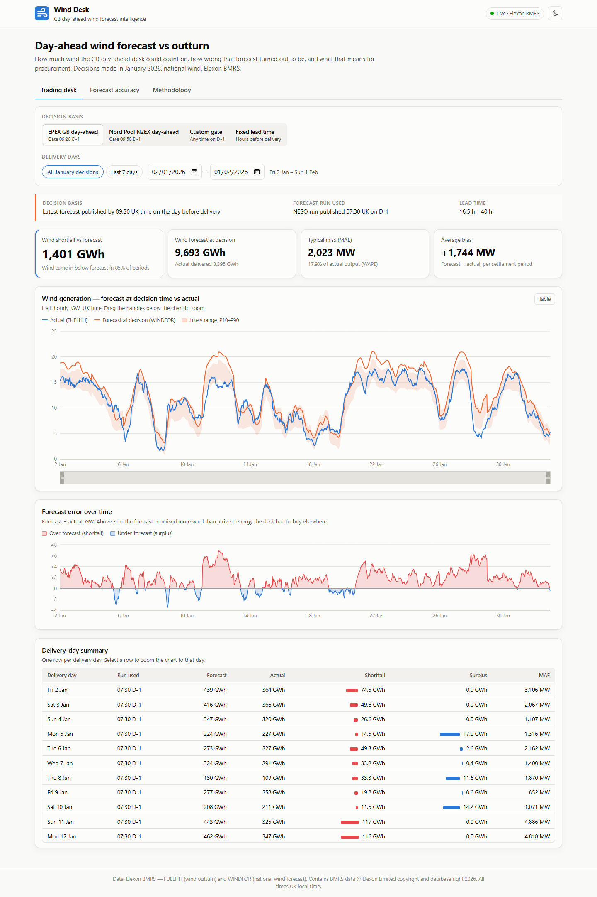
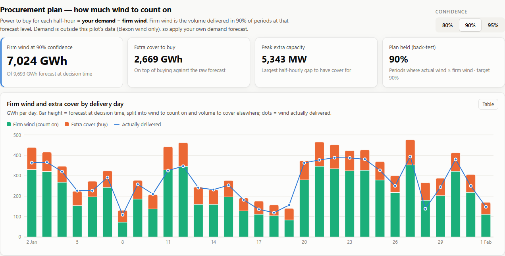
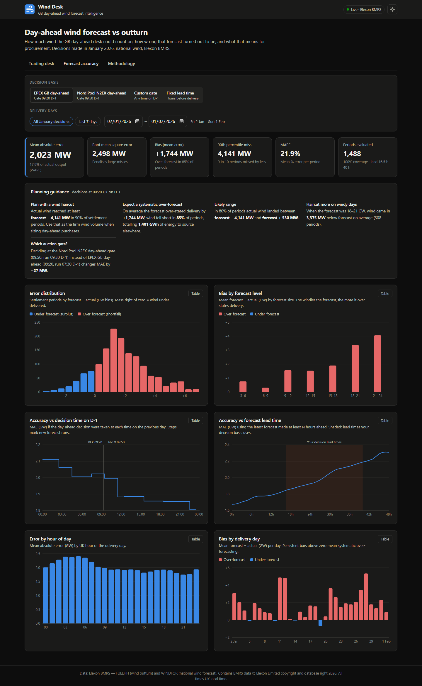
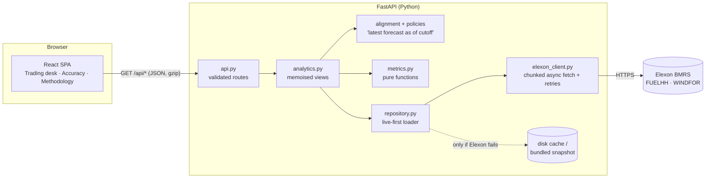

# Wind Desk — day-ahead wind forecast intelligence

A web app for a UK energy supplier's **day-ahead power purchasing desk**. It shows the national wind
forecast the desk could actually see at auction time and how far that forecast missed the real wind.
It turns those misses into planning numbers for procurement: how much extra power to buy beyond what the wind will cover.

- **Live app:** `<add your Vercel / Heroku URL here>`
- **API docs (OpenAPI):** `<app URL>/docs`
- **Data:** Elexon BMRS — `FUELHH` (actual wind generation) and `WINDFOR` (national wind forecast), fetched
  live, for purchase decisions made in **January 2026**.



---

## Contents

1. [What the product does](#what-the-product-does)
2. [Key findings — January 2026](#key-findings--january-2026)
3. [Quick start](#quick-start)
4. [Repository structure](#repository-structure)
5. [Architecture](#architecture)
6. [Methodology](#methodology)
7. [API reference](#api-reference)
8. [Configuration](#configuration)
9. [Testing and code quality](#testing-and-code-quality)
10. [Deployment](#deployment)
11. [Design decisions and trade-offs](#design-decisions-and-trade-offs)
12. [Limitations and next steps](#limitations-and-next-steps)
13. [Data sources and attribution](#data-sources-and-attribution)
14. [Use of AI tools](#use-of-ai-tools)

---

## What the product does

The desk buys power one day ahead in the GB day-ahead auctions. Whatever wind does not cover, it has to buy
from other sources (e.g. thermal plants). The app answers the desk's two questions:

| Need | Where | What you get |
| --- | --- | --- |
| **Understand the latest forecast available at decision time** | *Trading desk* tab | Half-hourly actual vs the forecast that was available at the auction gate (no hindsight), a P10–P90 likely-outturn band, the forecast run used and its lead time, a zoomable error timeline, and a per-delivery-day table of forecast vs actual energy, **shortfall** and surplus. |
| **Size purchases beyond wind** | *Trading desk* → *Procurement plan* | **Firm wind** the desk can count on at 80/90/95% confidence, **extra cover** to buy on top of the raw forecast, peak extra capacity (MW), and a back-test of how often the plan held, per delivery day. Power to buy = demand − firm wind. |
| **Quantify forecast accuracy to decide with the error in mind** | *Forecast accuracy* tab | MAE, RMSE, bias, WAPE, MAPE and P90 miss, plus plain-language **planning guidance** (e.g. "plan for forecast − 4,141 MW to be covered 90% of the time"). Error is broken down by size, by wind level, by decision time on D-1, by lead time, by hour of day and by delivery day. |

The **decision basis** filter changes every number on the page:

- **EPEX GB day-ahead gate (09:20 UK on D-1)**, the default.
- **Nord Pool N2EX gate (09:50 UK on D-1)**.
- **A custom decision time on D-1.**
- **A fixed lead time**, e.g. "the latest forecast made at least 6 h before each period".

A *Methodology* tab documents every definition for the client's analysts.





## Key findings — January 2026

These are computed live by the app for delivery days 2 Jan – 1 Feb 2026 (1,488 settlement periods). They
assume a 09:20 (EPEX) decision time.

- **The forecast over-states wind most of the time.** Mean error is **+1,744 MW**. Wind came in below forecast in
  **85%** of settlement periods, a total **shortfall of ~1,401 GWh** against 8,395 GWh actually delivered.
- **Typical miss:** MAE **2,023 MW** (WAPE 17.9%), RMSE 2,498 MW. One period in ten misses by more than 4,141 MW.
- **The bias grows with wind level.** When the forecast was 18–21 GW, actual wind was **~3.4 GW lower** on
  average, and lower in 100% of those periods. This fits wind being curtailed by grid constraints at high
  output. Treat it as a hypothesis to confirm with NESO.
- **Gate choice matters a little.** The 09:50 Nord Pool gate sees NESO's 09:30 forecast run instead of the
  07:30 one, which cuts MAE by ~27 MW. Accuracy falls steadily with lead time: from ~1.7 GW MAE at 0 h ahead to
  ~2.3 GW at 48 h ahead.

- **What the plan looks like.** At 90% confidence the desk could count on **7,024 GWh** of the 9,693 GWh
  forecast. That means **2,669 GWh of extra cover**, with a peak gap of 5.3 GW in any half-hour. In the
  back-test the plan held in **90.4%** of periods (80% → 80.4%, 95% → 94.1%), so the confidence levels are well
  calibrated.

**Takeaway for the desk:** don't plan on the raw forecast. A level-dependent "haircut" based on these error
quantiles is the conservative volume to treat as firm wind.

## Quick start

### Option A — Docker Compose (recommended)

```bash
docker compose up --build
```

- UI: <http://localhost:8080> (nginx serves the React build and proxies `/api`)
- API: <http://localhost:8000/docs>

On start-up the backend fetches January 2026 data **live from Elexon** (~2–3 s) and pre-computes the default
views. Run `DATA_MODE=snapshot docker compose up --build` to work fully offline.

### Option B — single container (same image as Heroku)

```bash
docker build -t wind-desk .
docker run -p 8000:8000 wind-desk        # UI + API on http://localhost:8000
```

### Option C — local development (hot reload)

Prerequisites: Python ≥ 3.11 and Node ≥ 22.12.

```bash
# terminal 1 - API on :8000
cd backend
python -m venv .venv
.venv/Scripts/activate            # Windows  (macOS/Linux: source .venv/bin/activate)
pip install -r requirements-dev.txt
uvicorn app.main:app --reload

# terminal 2 - UI on :5173 (Vite proxies /api to :8000)
cd frontend
npm ci
npm run dev
```

## Repository structure

```text
.
├── backend/                         Python API (FastAPI)
│   ├── app/
│   │   ├── main.py                  App factory: middleware, routes, error handling, start-up warm-up, optional SPA serving
│   │   ├── api.py                   HTTP routes + query validation (thin; maps analytics results to schemas)
│   │   ├── schemas.py               Pydantic response models - the API contract (camelCase on the wire)
│   │   ├── config.py                Settings from environment variables; decision/delivery-day window
│   │   ├── elexon_client.py         Async Elexon BMRS client: chunked, concurrent, retries with backoff, row validation
│   │   ├── repository.py            Live-first data loading with fallback cache/snapshot; background live retry
│   │   ├── snapshot.py              Gzipped-JSON persistence (disk cache + bundled snapshot), atomic writes
│   │   ├── domain.py                Core model: forecast runs, "latest forecast as of" lookup, half-hour interpolation
│   │   ├── policies.py              Forecast selection policies: day-ahead gate on D-1, fixed lead time; gate presets
│   │   ├── alignment.py             Settlement-period grid (DST-aware) and actual/forecast pairing
│   │   ├── metrics.py               Pure error metrics: MAE, RMSE, bias, WAPE, MAPE, quantiles, histogram, conditional band
│   │   ├── procurement.py           Firm wind / extra cover per delivery day at a chosen confidence, with back-test
│   │   └── analytics.py             Analytics service (memoised): evaluation, breakdowns, lead curve, gate sweep
│   ├── data/elexon_wind_snapshot.json.gz   Fallback copy of the same Elexon data (used only if Elexon is unreachable)
│   ├── scripts/build_snapshot.py    Re-creates the fallback snapshot from the live API
│   ├── tests/                       pytest: metrics, alignment/policies, procurement, client (mock HTTP), repository fallbacks, API contract
│   ├── requirements.txt             Runtime dependencies (pinned)
│   ├── requirements-dev.txt         + pytest, ruff
│   ├── pyproject.toml               pytest + ruff configuration
│   └── Dockerfile                   API image (used by docker-compose)
├── frontend/                        React UI (Vite + Recharts, plain CSS)
│   ├── src/
│   │   ├── App.jsx                  Layout, tabs, global filters (decision basis, delivery days), theme
│   │   ├── views/                   TradingDesk.jsx (view A) + ProcurementPanel.jsx, AccuracyView.jsx (view B), MethodologyView.jsx
│   │   ├── charts/                  One component per chart + chartKit.jsx (shared axes, ticks, tooltip, colours)
│   │   ├── components/              Header, FilterBar, ChartCard (chart/table toggle), DataTable, StatTile, Footer
│   │   ├── hooks/                   useApi (abortable fetch, keeps previous data), useDebouncedValue, useHashTab
│   │   ├── lib/                     api.js (URL building, errors), format.js (UK-time & number formatting)
│   │   └── styles/global.css        Design tokens (light/dark), layout, responsive rules
│   ├── nginx.conf                   Static serving + /api reverse proxy (docker-compose)
│   ├── vite.config.js               Dev server proxy, build, vitest config
│   ├── eslint.config.js
│   └── Dockerfile                   Multi-stage: build with Node, serve with nginx
├── api/index.py                     Vercel serverless entrypoint (re-exports the FastAPI app)
├── vercel.json                      Vercel build + /api rewrite
├── requirements.txt                 For Vercel's Python runtime (includes backend/requirements.txt)
├── Dockerfile                       Single-container production image (React build served by FastAPI)
├── heroku.yml                       Heroku container deployment
├── docker-compose.yml               Local two-container stack
├── .github/workflows/ci.yml         CI: lint + tests (backend & frontend), Docker build + smoke test
├── .env.example                     All configuration options, documented
└── docs/screenshots/                Images used in this README
```

## Architecture



**Request flow.** The UI holds two global filters: decision basis and delivery-day range. Each one maps to
query parameters on `/api/series`, `/api/evaluation`, `/api/lead-curve` and `/api/gate-sweep`. The backend
aligns every settlement period with its actual and its policy-selected forecast, then computes metrics.
Results are memoised per *(policy, day range)* because the underlying data is immutable once loaded. The
first call for a new policy takes ~20 ms; the full 49-point lead curve takes ~0.5 s once, and is pre-computed
at start-up.

**Data loading (live-first, fallback caching).**

1. On start-up, the backend fetches FUELHH (WIND) and WINDFOR **live from Elexon**. It splits the request into
   7-day chunks, fetched concurrently with timeouts, exponential-backoff retries and per-row validation. The
   result is held in memory and also written to a disk cache.
2. Only if Elexon is unreachable does it fall back, first to the disk cache (last good live fetch), then to a
   bundled snapshot of the same Elexon data. While on fallback data it retries Elexon in the background every
   5 minutes and switches back to live automatically.
3. The header badge (*Live · Elexon BMRS* / *Offline snapshot*) and `/api/health` always show which source is
   being served.

**Deployment shapes.** All three run the same FastAPI app:

- **docker-compose:** nginx + API containers.
- **Heroku / any container host:** one container in which FastAPI also serves the React build.
- **Vercel:** static React build plus a Python serverless function for `/api/*`.

## Methodology

**Decision window.** Purchase decisions made on 1–31 January 2026 deliver on **2 January – 1 February 2026**
(day-ahead = decision day + 1). Delivery days are UK settlement days, so clock-change days have 46/50 periods.

**Which forecast counts.** For each half-hourly target period:

1. Compute the decision cutoff. Default: **09:20 UK on D-1**, the EPEX SPOT GB day-ahead gate closure.
   Alternatives are 09:50 (Nord Pool N2EX), any custom time, or "N hours before the period".
2. Use the **latest WINDFOR run published at or before the cutoff**. Later runs are invisible, so there is no
   look-ahead bias.
3. Each WINDFOR run covers a window starting *before* its publish time (21:00 the previous day). Those rows are
   hindcasts, not forecasts, and are dropped.
4. WINDFOR is hourly and FUELHH half-hourly, so HH:30 values are linearly interpolated **within the same run**.

**Metrics.** Error = forecast − actual, so positive = over-forecast = shortfall to buy.

| Metric | Definition |
| --- | --- |
| MAE | mean \|error\| |
| RMSE | √ mean error² |
| Bias | mean error |
| WAPE | Σ\|error\| ÷ Σ actual |
| MAPE | mean(\|error\| ÷ actual) |
| P90 miss | 90th percentile of \|error\| |
| Shortfall / surplus energy | Σ max(±error, 0) × 0.5 h |

**Procurement plan.** For each period, *power to buy = demand − firm wind*. Firm wind at confidence *c* is
the forecast minus the error quantile *c* at that forecast level, so actual wind met or beat it in a share *c*
of periods. Extra cover = forecast − firm wind. The plan is back-tested against actual wind. Demand is outside
this pilot's data, which the brief limits to Elexon wind.

**Likely-outturn band (P10–P90).** Wind error is strongly level-dependent, so error quantiles are estimated
per 3 GW forecast band and linearly interpolated between bands. Bands with fewer than 50 periods are ignored.
Then P10 = forecast − errorP90 and P90 = forecast − errorP10.

## API reference

All endpoints are `GET` and return JSON. Interactive docs are at `/docs`.

| Endpoint | Purpose |
| --- | --- |
| `/api/health` | Liveness; data source, retrieval time, last error. Never triggers a data load. |
| `/api/meta` | Decision and delivery windows, gate presets, dataset provenance and counts |
| `/api/series` | Half-hourly actual, forecast, error, P10/P50/P90, run publish time, lead time, plus summary |
| `/api/evaluation` | Summary metrics, error histogram, breakdown by hour, delivery day and forecast level |
| `/api/lead-curve` | Accuracy vs lead time, 0–48 h |
| `/api/gate-sweep` | Accuracy vs decision time on D-1 (30-min grid plus the exact 09:20 and 09:50 gates) |
| `/api/procurement` | Firm wind, extra cover, peak extra capacity and back-test per delivery day; `confidence=0.5–0.99` (default 0.9) |
| `POST /api/admin/refresh` | Force a live re-fetch. Only enabled when `ADMIN_TOKEN` is set; send header `X-Admin-Token`. |

Common query parameters: `mode=dayahead|lead`, `gate=HH:MM` (UK time on D-1), `lead=<0-48 hours>`,
`start` and `end` (`YYYY-MM-DD` delivery days). Invalid values return `422`.

## Configuration

Everything is optional; defaults run live against Elexon. See [`.env.example`](.env.example).

| Variable | Default | Meaning |
| --- | --- | --- |
| `DATA_MODE` | `live` | `live` = Elexon first, fallback only on failure; `snapshot` = offline |
| `DECISION_MONTH` | `2026-01` | Month in which purchase decisions are made |
| `ELEXON_BASE_URL` | `https://data.elexon.co.uk/bmrs/api/v1` | BMRS Insights API |
| `HTTP_TIMEOUT_S` / `HTTP_RETRIES` | `30` / `3` | Per-request timeout and retry count |
| `CACHE_DIR` | `backend/.cache` (`/tmp/...` on Vercel) | Where the last good live fetch is kept |
| `CORS_ORIGINS` | `http://localhost:5173` | Allowed cross-origin callers |
| `STATIC_DIR` | unset | Serve the React build from FastAPI (set in the root Dockerfile) |
| `ADMIN_TOKEN` | unset | Enables `POST /api/admin/refresh` |
| `PORT` | `8000` | Container listen port (Heroku sets this) |

## Testing and code quality

```bash
cd backend  && ruff check . && ruff format --check . && pytest     # 60 tests, ~2 s, no network
cd frontend && npm run lint && npm test && npm run build              # 14 tests
```

- **Backend tests cover:**
  - metric maths against hand-computed values
  - quantile and histogram edge cases
  - the no-look-ahead forecast selection
  - half-hour interpolation
  - GMT/BST gate conversion and 46/50-period clock-change days
  - Elexon client chunking, validation, deduplication and retry (mocked HTTP)
  - the procurement plan (firm wind maths, confidence monotonicity, calibration of the back-test)
  - the live-first fallback chain
  - the full API contract, including input validation
- **Frontend tests cover** UK-time formatting across GMT/BST, number formatting and axis scaling.
- **CI** (`.github/workflows/ci.yml`) runs both suites, lints, builds the production Docker image and
  smoke-tests it.
- **Practices:**
  - typed, documented modules with one responsibility each
  - pure metric functions
  - dependency injection (HTTP transport, Elexon client, settings) for testability
  - 12-factor configuration
  - pinned dependencies
  - non-root containers with health checks
  - accessible charts: every chart has a *Table* view, keyboard-operable controls and colour-blind-safe palettes

## Deployment

### Vercel

1. Push this repo to GitHub, then in Vercel choose **Add New → Project → Import** this repository.
2. Leave the settings as detected. `vercel.json` sets the build (`frontend/dist`), the Python function
   (`api/index.py`) and the `/api/*` rewrite.
3. Deploy. Vercel serves the UI as static files, and `/api/*` runs the same FastAPI app as a serverless
   function. Its cache goes to `/tmp`, and the bundled snapshot is included for resilience.

CLI alternative: `npm i -g vercel && vercel --prod`.

### Heroku (container stack)

```bash
heroku create <app-name>
heroku stack:set container -a <app-name>
git push heroku main          # builds the root Dockerfile via heroku.yml
heroku open -a <app-name>
```

## Design decisions and trade-offs

- **No pandas or numpy.** About 1.5k settlement periods and 16k forecast values are tiny. Plain Python keeps the
  image at ~240 MB, the dependency list short, and serverless cold starts fast. Metric functions stay easy to
  test.
- **The forecast choice is a pluggable policy, not a hard-coded rule.** `DayAheadGate` and `FixedLead` share one
  interface, so the gate sweep and lead curve are simply loops over policies.
- **Live-first with fallback caching.** The data is fetched from Elexon on every start-up, as required. The
  cache and snapshot exist only so a client demo survives an Elexon outage, and the UI always shows the source.
- **The server computes; the client renders.** Metrics are computed in one tested place, the frontend stays
  thin, and payloads are small (gzip, ~57 KB for a month of half-hourly data).
- **Interpolating within one run, not across runs.** Mixing two runs would blend forecasts of different vintages
  and make the evaluation impossible to trace.
- **Recharts plus plain CSS.** This meets the brief with few dependencies. Colours come from a validated,
  colour-blind-safe palette with separate light and dark steps.

## Limitations and next steps

- The P10–P90 band and guidance are **in-sample** (calibrated on the month they describe). Production should
  calibrate on a rolling window of past days only and report backtested coverage.
- Scope is national transmission-connected wind only, per the brief. Adding **demand forecasts** would let the
  app show the residual volume to procure directly, and solar would be the next renewable to add.
- The high-wind over-forecast should be investigated with NESO (curtailment/constraints) before it drives policy.
- A persistent store (e.g. Postgres) and a scheduled ingest would replace start-up fetching once the app covers
  more than one month.
- Frontend component tests (React Testing Library) and visual regression tests would complement the current
  unit tests.

## Data sources and attribution

- Elexon BMRS Insights API — [FUELHH stream](https://bmrs.elexon.co.uk/api-documentation/endpoint/datasets/FUELHH/stream)
  and [WINDFOR stream](https://bmrs.elexon.co.uk/api-documentation/endpoint/datasets/WINDFOR/stream).
  *Contains BMRS data © Elexon Limited copyright and database right 2026.*
- GB day-ahead gate closure times:
  - Nord Pool [GB day-ahead auction](https://support.nordpoolgroup.com/support/solutions/articles/8000088463-about-the-day-ahead-gb-auction) (09:50)
  - DESNZ [consultation response on recoupling GB auctions](https://assets.publishing.service.gov.uk/media/64e5d4bfbc2b52000da004d3/recoupling-gb-auctions-for-cross-border-trade-with-eu-consultation-government-response.pdf) (EPEX 09:20, Nord Pool 09:50)

## Use of AI tools

This project was built with the help of an AI coding assistant, **Claude Code (Anthropic)**. It was used for
domain research (dataset structure, auction gate times), code generation for the backend, frontend and tests,
Docker/deployment configuration, and this README. All outputs were run and checked against the live Elexon API
and the automated test suites.
